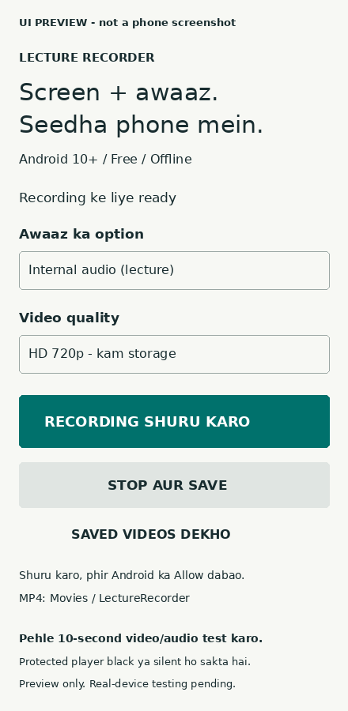

# Lecture Recorder app

Free, offline Android screen recording with internal lecture audio and optional microphone. Android 10+ (API 29). Native Java, Android framework APIs only: no paid library, ads, analytics, login, cloud uploads or Internet permission.

**Status v1.0.1: v1.0.0 recorded video but the audio track was silent on the owner's real phone (mean volume -91 dB). v1.0.1 changes audio capture (below) and adds a live audio meter, but the fix has NOT yet been verified on a real phone. Do the 10-second check before recording a class.** See TEST-REPORT.md.

## Install on a phone

Download the latest APK from this repository's [Releases](https://github.com/AKASH991833/lecture-recorder-app/releases) page, open it and allow installation from that browser or file manager only when Android asks. You can turn that permission off after installation. No laptop, Python, Termux or root is needed.

1. Open Lecture Recorder.
2. Keep the default **Auto: internal, silent ho to mic backup**. Other options: Internal + mic mix, Sirf mic, Bina audio, Sirf internal (no backup).
3. Choose HD 720p (smaller file) or Full HD 1080p.
4. Tap **RECORDING SHURU KARO**. Grant audio permission and approve Android's screen-sharing prompt. On Android 14+ choose one app or full screen.
5. Open the lecture player. Recording continues with a persistent notification.
6. Tap **Stop aur save** in the notification, or return to the app and tap **STOP AUR SAVE**.
7. Watch the two **live meter bars** on the home screen for the first 10 seconds. The internal bar should move while the lecture plays. If it does not, the player blocks capture: Auto mode switches to the mic (headphones off, volume up) and the status says so.
8. Your MP4 is in **Movies/LectureRecorder**, visible in Gallery. Always play the first short sample and check the sound.

## Zoom / live class (important)

Zoom ki live awaaz VoIP (call audio) hoti hai, aur Android internal audio capture ise nahi pakad sakta. Isliye v1.0.0 mein video aaya par audio silent tha. Zoom live ke liye: **Auto** option rakho, phone ka **speaker ON** rakho (headphone nahi), volume up - app mic backup se awaaz record karegi (room ki awaaz bhi aa sakti hai). Recorded video, Chrome, YouTube jaise players mein internal audio chal sakta hai. Zoom khud mic use karta hai, aur kuch phones mic share nahi karte, isliye pehle 10-second test zaroor karo. USAGE_VOICE_COMMUNICATION capture add nahi kiya: Android ise capture ke liye allow nahi karta aur isse app crash ho sakta hai.

## What changed in v1.0.1 (audio)

- Default mode is now Auto: internal playback capture (USAGE_MEDIA, USAGE_GAME, USAGE_UNKNOWN) with the microphone also opened. When internal audio has been silent for 3 seconds the mic is mixed in at full level, so the file is not silent; when internal audio returns the mic is dropped.
- Foreground service type now includes microphone for every mode that uses the mic (mediaProjection|microphone); permissions were already declared.
- If internal capture fails to start, Auto mode falls back to the mic instead of failing; Internal-only mode reports the error.
- Live meter bars (internal and mic) on screen, status in the notification, and a WARNING in the final message if the whole recording stayed silent.
- Known cause of silent internal audio: apps can opt out of playback capture or use protected audio. This app does not bypass that. Mic fallback records speaker sound (so it also picks up room noise); with headphones it records almost nothing, so use the speaker for fallback.
- If the update will not install over v1.0.0 (different debug signing key), uninstall v1.0.0 first.

## Features

- Consent-based MediaProjection screen capture, H.264 video up to 30fps, AAC mono 48kHz / 128kbps audio.
- Internal playback capture on Android 10+, optional mic (mixed at half gain to limit clipping).
- Large controls, simple Hinglish labels, recording time and audio-activity status.
- 720p/1080p long-edge caps, 3.5/6Mbps video target bitrate.
- Stop notification; automatic cleanup if Android withdraws projection.
- Streams encoded output directly to disk, with bounded startup buffering and low-space stop. No fixed duration cap.
- Scoped MediaStore save: no broad storage access needed. No network access.

## Important limits

**Protected video can appear black; internal audio can be silent.** Android lets players and work profiles block capture. This app cannot and does not bypass DRM, FLAG_SECURE, device limits or a player's capture policy. A silent-audio notice detects low audio levels, not whether the teacher is speaking. Microphone-only mode records room sound, not a workaround for video protection.

Internal audio requires Android 10+, RECORD_AUDIO permission, and a player that allows capture in the same Android user profile. Calls, protected streams and many older apps cannot be captured. Do not promise this will record any particular LMS until a sample is checked.

Resolution is fixed at recording start. Rotation is allowed, but may show letterboxing on newer Android and cropping/rotation differences on older devices. Start landscape for landscape lectures. App-window sharing is offered by Android 14+, not older Android.

For long classes: keep the phone charged, screen awake, enough storage free, and avoid force-close or battery-saver restrictions. At the target bitrate HD can use about 1.6GB/hour and Full HD about 2.8GB/hour; actual output varies. No hour-long real-device test has been performed. Abrupt process kill/power loss before Stop may lose the current MP4; this version does not claim crash recovery or segmented recording. Android may stop capture when the screen locks.

Record only material you have permission to record. Full-screen capture can include private notifications, chats and passwords. Use DND or single-app sharing. Files stay on your phone unless you share them yourself.

## Source and build

The complete Gradle source is included in `lecture-recorder-source-v1.0.1.zip` (excluding build files, local paths and signing keys). Extract it, install Android SDK 34 and Java 17, then run `./gradlew :app:assembleDebug` (`gradlew.bat` on Windows). Output: `app/build/outputs/apk/debug/app-debug.apk`.

The supplied APK is a debug-signed sideload build, not a Play Store release. Android may warn for an unknown developer. No special accessibility, overlay or device-admin permission is needed. For a published production app, use your own private signing key; never put a signing key in the public repository.

## Screenshots

UI preview images are illustrative previews based on the actual labels and layout; they are not screenshots from a phone and do not prove recording functionality.

## Test results

See [TEST-REPORT.md](5-TEST-REPORT.md). Compilation and static checks are not substitutes for a real-device recording/audio test.

## Android documentation

- https://developer.android.com/media/platform/av-capture
- https://developer.android.com/media/grow/media-projection
- https://developer.android.com/about/versions/14/changes/fgs-types-required
